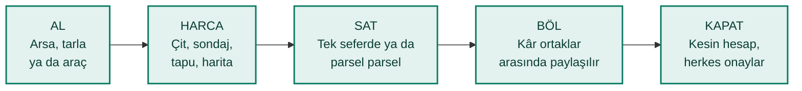
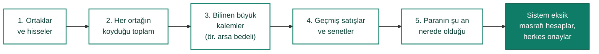
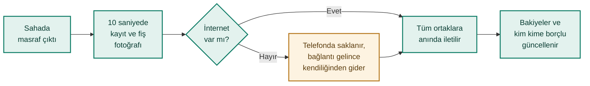
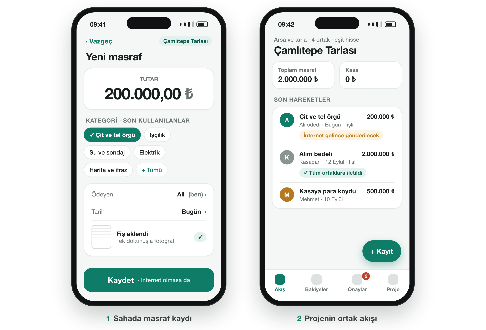
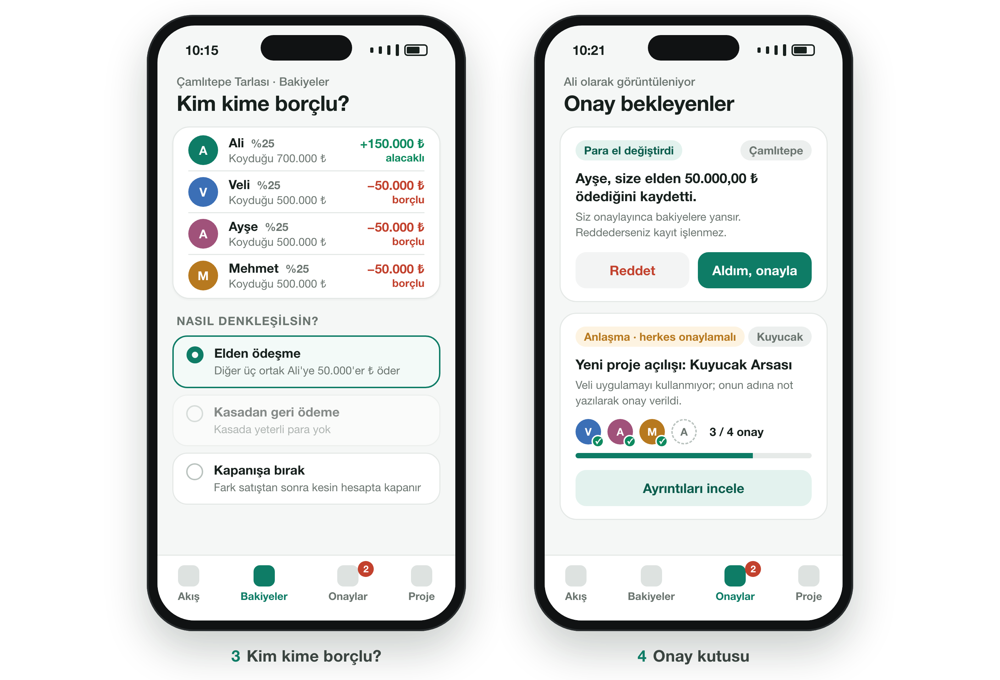
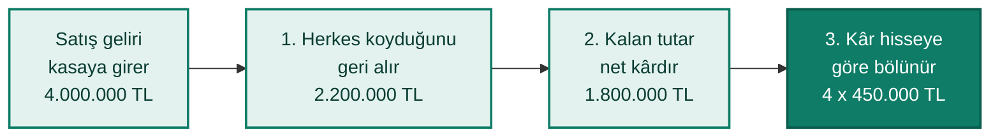
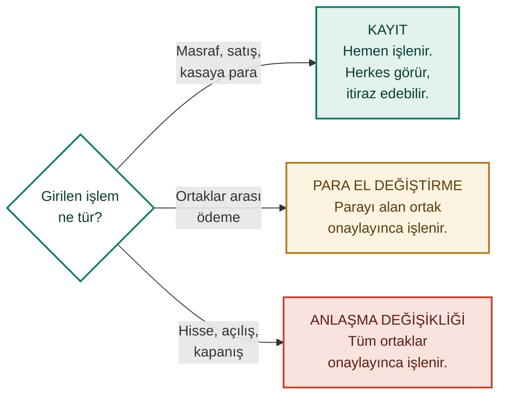
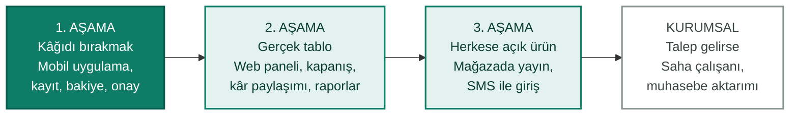

# Bu Doküman Hakkında

Bu doküman, ortaklı alım-satım işleri için tasarlanan **Paydaş** uygulamasının gayrimenkul sektöründe çalışan bir profesyonelin gözüyle değerlendirilmesi amacıyla hazırlanmıştır. Teknik ayrıntılara yer verilmemiştir. Ürünün ne işe yaradığı, nasıl kullanıldığı ve hangi kurallarla çalıştığı tek bir arsa projesinin hikâyesi üzerinden anlatılmaktadır.

Dokümanın sonunda, sektör deneyimine dayanan görüşlerin toplanması için kısa bir soru listesi ve puanlama tablosu yer almaktadır. Ürünün eksik veya gereksiz bulunan yönleri de en az beğenilen yönleri kadar değerlidir.

> **Bilgi:** Paydaş şu anda tasarım aşamasındadır ve "Paydaş" ürünün çalışma adıdır. Dokümandaki ekran görüntüleri temsili taslaklardır. Nihai tasarım bu değerlendirmeden gelecek geri bildirimlerle şekillenecektir. Tahmini okuma süresi 15 dakikadır.

# Sorun: Ortaklı İşin Hesabı Kâğıtta Kalıyor

Sektörde sıkça görülen bir senaryo düşünülsün: Dört arkadaş bir araya gelip bir tarla alır, çevirip parsellere ayırır ve hobi bahçesi olarak satar. Süreç aylar, bazen yıllar sürer. Bu sürede çit çekilir, sondaj vurulur, elektrik getirilir, harita ve ifraz işleri yapılır, tapu harcı ve emlakçı komisyonu ödenir.

Masrafların bir kısmı ortak kasadan, bir kısmı ortakların kendi cebinden ödenir. Kayıtlar bir deftere, bir WhatsApp grubuna ya da birinin aklına yazılır. Fişler arabanın torpidosunda kaybolur. İş satış aşamasına geldiğinde ise üç soru cevapsız kalır:

1. **Bu iş gerçekte ne kadar kazandırdı?**
2. **Kim ne kadar koydu, kim kime borçlu?**
3. **Dün sahada yapılan masrafı diğer ortaklar ne zaman ve nereden öğrenecek?**

Cevapsız kalan bu sorular zamanla ortaklar arasında güvensizliğe, kimi zaman da dostlukların bozulmasına yol açar. Paydaş bu sorunu çözmek için tasarlanmıştır ve ilk olarak dört ortaklı, gerçek bir tarla projesinde denenecektir.

## Bugünkü Yöntemlerle Karşılaştırma

| İhtiyaç | Kâğıt defter | WhatsApp grubu | Excel | Paydaş |
| --- | --- | --- | --- | --- |
| Kayıt kaybolmaz | ❌ | ⚠️ | ⚠️ | ✅ |
| Tüm ortaklar anında görür | ❌ | ✅ | ⚠️ | ✅ |
| Fiş fotoğrafı kayda bağlı durur | ❌ | ⚠️ | ❌ | ✅ |
| Sahada internetsiz kayıt | ✅ | ❌ | ⚠️ | ✅ |
| Kim kime borçlu kendiliğinden hesaplanır | ❌ | ❌ | ⚠️ | ✅ |
| Değişiklik geçmişi ve itiraz hakkı | ❌ | ❌ | ❌ | ✅ |
| Para alışverişinde karşı tarafın onayı | ❌ | ❌ | ❌ | ✅ |
| Kâr paylaşımı ve kesin hesap | ❌ | ❌ | ⚠️ | ✅ |

> ✅ Var · ⚠️ Kısmen ya da birinin ek emeğiyle · ❌ Yok

# Paydaş Nedir?

**Paydaş; ortaklı ya da tek başına yapılan alım-satım işlerinin masrafını, kârını ve ortaklar arasındaki hesaplaşmayı telefondan takip eden bir uygulamadır.**

Her iş bir **proje** olarak açılır ve aşağıdaki döngüyü izler:

Temel fikir basittir: Masraf her an çıkabilir ve insanın yanında her an telefonu vardır. Bu nedenle kayıt girmek birkaç saniye sürmeli, fiş fotoğrafı tek dokunuşla eklenebilmeli ve tarlada internet çekmese bile hiçbir kayıt kaybolmamalıdır. Hesapların tamamı uygulama tarafından yapılır; ortakların formül kurmasına veya elle toplama yapmasına gerek kalmaz.

## Kimler İçin?

- **Ortaklı arsa ve tarla alanlar:** hisseli alımlar, hobi bahçesi ve parselleme işleri.
- **Oto alım-satımcılar:** aracı alıp bakım, boya ve ekspertiz masrafı yaptıktan sonra satanlar.
- **Küçük yatırımcılar ve müteahhitler:** daire alıp tadilat ederek satanlar.
- **Tek başına iş yapanlar:** ortak olmadan yapılan bir iş de tek ortaklı (%100 hisseli) proje olarak takip edilebilir.

Öncelik bireysel ortaklıklar ve küçük tüccarlardır. Ürün, ileride kurumsal firmalara da açılabilecek şekilde tasarlanmaktadır.

## Bilinmesi Gereken Altı Kavram

| Kavram | Anlamı |
| --- | --- |
| Proje | Bir alım-satım işi, örneğin "Çamlıtepe Tarlası". Arsa-tarla, araç ve genel iş şablonları hazır masraf kalemleriyle gelir. |
| Ortak | Projede hissesi olan kişi ya da şirket. Uygulamayı kullanmayan biri de ortak olarak eklenebilir. |
| Hisse | Ortağın projedeki payı. Varsayılan olarak kâr da zarar da bu orana göre paylaşılır. |
| Kasa | Projenin ortak parası, örneğin ortak bir banka hesabı. Proje parası ortaklardan birinin elinde de durabilir. |
| Kayıt | Masraf, satış geliri, kasaya para koyma ya da ortaklar arası ödeme gibi her olay. |
| Onay | Para el değiştirdiğinde veya ortaklık anlaşması değiştiğinde ilgili ortakların verdiği onay. |

# Bir Projenin Hikâyesi: Çamlıtepe Tarlası

Paydaş'ın nasıl çalıştığı, dört ortaklı hayali bir proje üzerinden adım adım anlatılmaktadır. Ortaklar **Ali, Veli, Ayşe ve Mehmet**'tir ve her birinin hissesi **%25**'tir.

## Proje Açılır, Ortaklar Davet Edilir

Ali uygulamada "Çamlıtepe Tarlası" adıyla yeni bir proje açar ve proje tipi olarak **Arsa ve tarla** seçeneğini işaretler. Böylece alım bedeli, tapu harcı, emlakçı komisyonu, harita ve ifraz, çit, sondaj, elektrik gibi masraf kalemleri hazır gelir.

Ardından ortaklar ve hisseleri girilir. Ali, uygulamanın ürettiği **davet linkini** WhatsApp grubuna gönderir; Ayşe ve Mehmet linke dokunarak katılır. Veli ise uygulamayı kullanmak istemez. Bu bir engel oluşturmaz: Veli yine ortak olarak eklenir ve hesabı tutulur. Onun onayı gereken durumlarda diğer ortaklardan biri **not yazmak şartıyla** Veli adına onay verebilir. Bu onay, geçmişte ayrıca işaretlenir.

Ortaklık yapısı bir anlaşma olduğu için proje, **tüm ortaklar onayladığında** başlar.

## Yarım Kalmış İş de Aktarılır

Çoğu ortaklık uygulamayla tanıştığında iş çoktan yarılanmış olur. Geçmiş masrafların ayrıntısı kaybolmuştur ama "kim toplam ne kadar koydu" genellikle bellidir. Paydaş bu durum için beş adımlık bir **açılış sihirbazı** sunar:

Sistem, girilen rakamlardan kayıp masrafların toplamını kendisi hesaplar. Örneğin ortaklar toplam 2.000.000 TL koymuş, arsa 1.600.000 TL'ye alınmış ve kasada 100.000 TL duruyorsa, aradaki **300.000 TL "aktarım öncesi masraflar"** olarak kaydedilir. Rakamlar birbirini tutmazsa sihirbaz uyarı verir ve onaya göndermeye izin vermez. Açılış durumu tüm ortakların onayıyla kilitlenir; o günden sonra her şey uygulamadan yürür.

## Sahada 10 Saniyede Kayıt

Çamlıtepe'ye dönülsün. Arsa, ortakların kasaya koyduğu 500'er bin TL ile 2.000.000 TL'ye alınır. Birkaç hafta sonra Ali, çit için ustaya **200.000 TL'yi kendi cebinden** öder ve daha tarladayken telefonu çıkarır:

1. Tutarı yazar.
2. "Çit ve tel örgü" kategorisine dokunur.
3. Fişin fotoğrafını çeker ve **Kaydet** düğmesine basar.

Ödeyen kişi varsayılan olarak Ali'nin kendisi, tarih ise bugündür. Son kullanılan kategoriler en üstte çıkar. Hedef, kaydın uygulama açıldıktan sonra **10 saniye içinde** tamamlanmasıdır. Tarlada internet çekmiyorsa kayıt telefonda saklanır ve bağlantı geldiğinde kendiliğinden gönderilir:

Gerektiğinde **geçmiş tarihli** kayıt da girilebilir. Ayrıca bir ortak, başka bir ortağın yaptığı ödemeyi onun adına kaydedebilir. Böylece o sırada telefonu yanında olmayan ortağın masrafı da kayda geçer.

{width=100%}

*Temsili ekran taslakları: hızlı masraf kaydı ve projenin ortak akışı.*

## Herkes Görür, Kimse Gizlice Değiştiremez

Kayıt, sunucuya ulaştığı anda projenin akışında görünür ve tüm ortaklara iletilir. Güveni korumak için şu kurallar uygulanır:

- **Kaydı yalnızca giren kişi düzeltebilir veya iptal edebilir.** Düzeltme eski kaydı silmez; önceki hâli geçmişte herkese açık kalır.
- **Diğer ortaklar itiraz edebilir.** İtiraz edilen kayıt "tartışmalı" olarak işaretlenir ve raporlarda ayrıca gösterilir. Kayıt düzeltildiğinde ya da itiraz geri çekildiğinde işaret kalkar.
- **Mükerrer kayıt uyarısı verilir.** Aynı projede, aynı tutar ve kategoride, tarihleri birbirine üç günden yakın iki kayıt "olası mükerrer" olarak işaretlenir.
- **Hiçbir kayıt silinmez.** Bakiyeler her zaman geçmişi izlenebilen kayıtlardan hesaplanır.

## Kim Kime Borçlu?

Ali'nin ödediği 200.000 TL ile birlikte projeye toplam 2.200.000 TL konmuştur. Hisseler eşit olduğundan her ortağın payına 550.000 TL düşer. Paydaş tabloyu kendiliğinden çıkarır:

| Ortak | Koyduğu | Payına düşen | Durum |
| --- | --- | --- | --- |
| Ali | 700.000 TL | 550.000 TL | **150.000 TL alacaklı** |
| Veli, Ayşe, Mehmet (her biri) | 500.000 TL | 550.000 TL | 50.000 TL borçlu |

Uygulama yalnızca durumu göstermekle kalmaz, **denkleşme yollarını rakamlarıyla önerir**:

- **Elden ödeşme:** Veli, Ayşe ve Mehmet, Ali'ye 50.000'er TL öder. Borçlu ortaklar alacaklı ortaklarla, ödeme sayısını azaltacak biçimde eşleştirilir.
- **Kasadan geri ödeme:** Kasada para varsa Ali'ye kasadan ödeme yapılır. Bu durumda Ali'ye 150.000 TL değil, **200.000 TL'nin tamamı** ödenir. Çünkü kasa dört ortağın ortak parasıdır ve masraf bu yolla dördü tarafından birlikte üstlenilmiş olur. Bu tür ince hesaplar uygulama tarafından kendiliğinden yapılır.
- **Kapanışa bırakma:** Hiçbir işlem yapılmaz; fark, iş bittiğinde kesin hesapta kapanır.
- **Hisseye dahil etme (2. aşama):** Ortaklar isterse Ali'nin fazladan ödediği tutar hissesine yansıtılır. Ali'nin hissesi %25'ten yaklaşık %31,8'e çıkar, diğerlerininki %22,7'ye iner.

{width=100%}

*Temsili ekran taslakları: kim kime borçlu ekranı ve onay kutusu.*

Elden ödeşme seçildiğinde ödeme kayıtları oluşturulur, ancak **parayı alan kişi onaylamadan hiçbir ödeme bakiyelere yansımaz.** Ali, Ayşe'nin verdiği 50.000 TL'yi eline aldığında "Aldım, onayla" düğmesine basar ve bakiye güncellenir.

## Satış, Kâr Paylaşımı ve Kapanış

Bu bölüm için ortakların farkı kapanışa bıraktığı varsayılsın. Parseller zamanla satılır ve toplam **4.000.000 TL** kasaya girer. İş bittiğinde kesin hesap şu sırayla çıkarılır:

| Ortak | Koyduğunun iadesi | Kâr payı | Toplam ödeme |
| --- | --- | --- | --- |
| Ali | 700.000 TL | 450.000 TL | **1.150.000 TL** |
| Veli | 500.000 TL | 450.000 TL | **950.000 TL** |
| Ayşe | 500.000 TL | 450.000 TL | **950.000 TL** |
| Mehmet | 500.000 TL | 450.000 TL | **950.000 TL** |
| **Toplam** | 2.200.000 TL | 1.800.000 TL | **4.000.000 TL** |

Dağıtılan toplam, kasadaki paraya kuruşu kuruşuna eşittir. Elden ödeşme daha önce yapılmış olsaydı her ortağa 1.000.000 TL ödenecekti; sonuç değişmez, yalnızca ödemenin zamanı değişir. Kapanış önerisi tüm ortakların onayına gider. Ödemeler yapılıp her ortak payını aldığını onayladığında proje kapanır.

**Emek payı:** Ortaklardan biri sahada daha çok çalışıyorsa bu emek karşılık bulabilir. Örneğin "kârın %20'si önce Mehmet'e verilsin, kalanı eşit bölünsün" denirse Mehmet'in kâr payı 450.000 TL'den 720.000 TL'ye çıkar, diğerlerininki 360.000 TL'ye iner. Emeğin karşılığı kârdan pay yerine sabit bir ücret olarak da belirlenebilir. Proje zarar ederse zarar, hisse oranlarına göre paylaşılır.

Satış tarafında ayrıca şu imkânlar planlanmaktadır:

- **Senetli satış ve tahsilat takibi:** Satış ile tahsilat ayrı izlenir; kâr yalnızca tahsil edilen paradan dağıtılır.
- **Ara dağıtım:** İş bitmeden, satılan parsellerin parasından kâr payı dağıtılabilir.
- **Parsel bazında maliyet ve başabaş fiyatı:** Her parselin maliyeti ve zarar etmeden satılabileceği fiyat görülür.
- **Enflasyondan arındırılmış getiri:** Kur ve TÜFE verisiyle "gerçekten kazandık mı?" sorusu cevaplanır.

> **Not:** Kapanış, kâr paylaşımı ve bu bölümdeki diğer imkânlar ürünün 2. aşamasında yer almaktadır. İlk sürüm, kayıt tutma ve "kim kime borçlu" hesabına odaklanır.

## Ortaklık Yolda Değişirse

Uzun süren işlerde ortaklık yapısı değişebilir. Paydaş bu durumları adım adım yönlendiren dört akışla karşılar. Her değişiklik **tüm ortakların onayını** gerektirir ve kalıcı olarak kayda geçer.

| Durum | Paydaş'ta karşılığı |
| --- | --- |
| Hisse devri | Ortak, payını pazarlıkla belirlenen bir fiyata başka bir ortağa devreder. Ödenen fiyat not olarak kaydedilir. |
| Ortaklıktan çıkış | Ayrılan ortağa koyduğu sermaye proje parasından iade edilir. Para yetmezse ödemeyi kalan ortaklar yapar. |
| Yeni ortak girişi | Yeni ortak sermaye koyarak katılır ve yeni hisseler birlikte belirlenir. |
| Masrafı hisseye dahil etme | Fazla ödeme yapan ortağın hissesi, koyduğu paraya göre yeniden hesaplanır. |

> **Not:** Ortaklık değişiklikleri 2. aşamada yer almaktadır. Kâr, kapanış anındaki hisselere göre paylaştırılır.

# Güven Kuralları

## Üç Onay Seviyesi

Her işlemin onaya gitmesi uygulamayı kullanılmaz hâle getirir; hiç onay olmaması ise güveni zedeler. Paydaş bu dengeyi üç seviyeyle kurar:

- **Masraflar neden onaysız işlenir?** Her çit direği için dört ortağın onayını beklemek, ortakları yeniden deftere ve WhatsApp'a döndürür. Bunun yerine kayıt hemen işlenir, herkes görür ve itiraz hakkı saklı kalır. Tutar ne olursa olsun kural aynıdır.
- **Tek bir ret, talebin tamamını reddeder.** Teklifi yapan kişi düzeltip yeniden gönderir.
- **Onaylar ve retler de kalıcıdır.** Kimin neyi ne zaman onayladığı her zaman görülebilir.
- **Uygulamayı kullanmayan ortak** adına başka bir ortak, not yazarak onay verebilir. Uygulamayı kullanan bir ortak adına ise onay verilemez.

## Gizlilik ve Güvenlik

- **Her ortaklık grubunun verisi diğerlerinden tamamen ayrıdır.** Bir grubun kayıtları başka bir gruba hiçbir koşulda görünmez.
- **Projeler varsayılan olarak gizlidir** ve yalnızca projenin ortaklarına görünür. Proje aynı gruptaki diğer kişilere açılabilir; bu kişiler yalnızca görüntüleyebilir ve açma kararı da tüm ortakların onayını gerektirir.
- **Yönetici olmak, rakamları görme yetkisi vermez.** Gruba kişi davet eden yönetici bile ortağı olmadığı projenin rakamlarını göremez.
- **Gruptan çıkarılan kişinin ortaklık hakkı silinmez.** Erişimi kapanır ama bakiyesi yerinde kalır.
- **Fiş fotoğrafları kapalı bir depoda saklanır** ve yalnızca yetkili kişiye açılır.
- **Her gün yedek alınır.** Yedekler ayrı bir yerde tutulur ve geri yükleme ayda bir denenir.
- **Giriş** e-posta, Google veya Apple hesabıyla yapılır. SMS ile giriş sonraki aşamalarda eklenecektir.

# Tüm Özellikler ve Yol Haritası

Ürün aşamalar hâlinde geliştirilecektir. İlk sürüm sahadaki kayıt sorununu çözer; sonraki aşamalar kesin hesabı, web panelini ve herkese açık ürünü getirir.

| Özellik | Ne işe yarar? | Aşama |
| --- | --- | --- |
| Davet linki | Ortaklar WhatsApp'tan gönderilen bir linkle katılır. | 1 |
| Uygulamayı kullanmayan ortak | Telefonla arası olmayan ortak da hesapta yer alır. | 1 |
| Hazır proje şablonları | Arsa-tarla, araç ve genel işler için masraf kalemleri hazır gelir. | 1 |
| Açılış sihirbazı | Yarım kalmış iş, geçmişiyle birlikte aktarılır. | 1 |
| Hızlı kayıt ve fiş fotoğrafı | Masraf 10 saniyede, fişiyle birlikte kaydedilir. | 1 |
| İnternetsiz kayıt | Tarlada internet çekmese de kayıt kaybolmaz. | 1 |
| Geçmiş tarihli ve başkası adına kayıt | Unutulan ya da başka ortağın ödediği masraf girilir. | 1 |
| Düzeltme geçmişi, itiraz ve mükerrer uyarısı | Hiçbir kayıt iz bırakmadan değişmez. | 1 |
| Kim kime borçlu ve ödeşme önerileri | Denkleşme yolları rakamlarıyla önerilir. | 1 |
| Onay kutusu | Para alışverişi ve anlaşma değişiklikleri onaya düşer. | 1 |
| Gizli ve açık projeler | Proje varsayılan olarak yalnızca ortaklarına görünür. | 1 |
| Web paneli ve raporlar | Tüm işlemler bilgisayardan da yapılır. | 2 |
| Kapanış ve kâr paylaşımı | Kesin hesap çıkarılır, tüm ortaklar onaylar. | 2 |
| Emek payı ve sabit ücret | Sahada çalışan ortağın emeği karşılık bulur. | 2 |
| Ortaklık değişiklikleri | Devir, çıkış, yeni ortak girişi ve masrafı hisseye katma. | 2 |
| Senetli satış ve ara dağıtım | Vadeli satış izlenir, iş bitmeden kâr dağıtılabilir. | 2 |
| Parsel bazında maliyet | Her parselin maliyeti ve başabaş fiyatı görülür. | 2 |
| Enflasyondan arındırılmış getiri | Kur ve TÜFE ile gerçek kazanç hesaplanır. | 2 |
| Anlık bildirim ve e-posta | Yeni kayıt ve onaylar telefona bildirim olarak gelir. | 2 |
| Mağazada yayın, SMS ile giriş, biyometrik kilit | Ürün herkese açılır, giriş ve güvenlik kolaylaşır. | 3 |
| Saha çalışanı, avans ve muhasebe aktarımı | Kurumsal firmaların ihtiyaçları karşılanır. | Kurumsal |

> **İlk hedef:** Süren gerçek bir arsa projesinin açılış durumu tüm ortakların onayıyla uygulamaya girilecek, sonraki dört hafta boyunca bütün masraflar yalnızca uygulamadan kaydedilecek ve ortaklar "kim kime borçlu" sorusunun cevabını uygulamadan okuyacaktır.

# Paydaş Ne Değildir?

Beklentilerin doğru kurulması için kapsam dışında bırakılan konular aşağıda listelenmiştir:

- **Resmi muhasebe veya vergi programı değildir.** E-fatura, KDV, beyanname, stok ve bordro işleri yapılmaz. Gerektiğinde muhasebeciye aktarılabilecek dökümler verilmesi planlanmaktadır.
- **Para göndermez.** Banka hesaplarına bağlanmaz; yapılan ödemelerin kaydını tutar.
- **İlan, portföy veya müşteri takip programı değildir.**
- **Sürekli işleyen bir işletmenin hesabını tutmaz.** Başlangıcı ve sonu olan alım-satım işleri için tasarlanmıştır.
- **Resmi kurum sistemlerine bağlı değildir.** Tapu veya belediye kayıtlarıyla bağlantı kurulmaz.

# Değerlendirme

Bu bölümdeki sorular, ürünün sektörde gerçek bir karşılığı olup olmadığını ve neyin eksik kaldığını anlamak için hazırlanmıştır. Kısa cevaplar da en az uzun cevaplar kadar değerlidir ve her soruya cevap verilmesi gerekmez.

## Sorular

### Sorun ve hedef kitle

1. Çevrede ortaklı arsa ve tarla alımı ne sıklıkla görülmektedir? Bu ortaklıklarda hesap bugün nasıl tutulmaktadır?
2. Ortaklar arasında en sık hangi konuda anlaşmazlık çıkmaktadır: masraflar, kâr paylaşımı, ortak çıkışı ya da başka bir konu?
3. Bu uygulamayı en çok kim kullanır: hobi bahçesi yapanlar, yatırımcı grupları, küçük müteahhitler ya da emlakçıların kendisi?
4. Emlakçılar bu tür ortaklıklarda ortak, aracı ya da danışman olarak yer almakta mıdır? Yer alıyorsa uygulamada nasıl bir rolleri olmalıdır (örneğin komisyon takibi veya yalnızca görüntüleme yetkisi)?
5. Bir emlakçı bu uygulamayı müşterilerine önerir miydi?

### Kullanım ve kurallar

6. On saniyelik masraf kaydı sahadaki gerçeğe uygun mudur? Sahada başka neye ihtiyaç duyulur?
7. Masrafların onay beklemeden işlenmesi ve itiraz hakkı doğru bir denge midir, yoksa belirli bir tutarın üstündeki masraflar onaya mı gitmelidir?
8. Hisse değişikliği ve kapanış gibi kararlarda tüm ortakların onayı (oybirliği) pratikte uygulanabilir midir?

### Satış ve ortaklık pratikleri

9. Parsel parsel satış, senetli veya taksitli satış ve kapora ne kadar yaygındır? Alıcı bilgilerinin de tutulması gerekir mi?
10. Ortaklıktan çıkan ortağa koyduğu para mı ödenmelidir, yoksa arsanın güncel değeri üzerinden mi hesap yapılmalıdır?
11. Farklı zamanlarda konan eşit tutarlar (örneğin iki yıl arayla konan 100.000 TL) hesaplaşmada eşit mi sayılmalıdır?
12. Satılmadan önce kiraya verilen mülklerde kira gelirinin de takip edilmesi gerekir mi?

### Kapsam ve ücret

13. Tapu, imar ve ifraz gibi resmi süreçlerin hangi aşamada olduğunun takibi bir ihtiyaç mıdır?
14. Bu tür bir uygulama için aylık ya da proje başına ücret ödenir mi? Makul bir fiyat aralığı nedir?
15. Ürünün en beğenilen ve en gereksiz bulunan özelliği hangisidir? Eksik olan tek bir şey söylenecek olsa bu ne olurdu?

## Masraf Kalemleri Kontrolü

Arsa ve tarla projeleri için hazır gelen masraf kalemleri aşağıdadır. Eksik, gereksiz veya farklı adlandırılması gereken kalemlerin belirtilmesi beklenmektedir:

Alım bedeli · Tapu harcı ve döner sermaye · Emlakçı komisyonu · Noter · Harita, ifraz ve kadastro · Avukat ve danışmanlık · Çit ve tel örgü · Su ve sondaj · Elektrik · Yol ve hafriyat · Fidan ve peyzaj · İşçilik · Malzeme · İlan ve reklam · Emlak vergisi · Ulaşım ve yakıt · Diğer

## Puanlama Tablosu

Her kriter 1 (çok zayıf) ile 5 (çok iyi) arasında puanlanabilir. Uygun puanın işaretlenmesi yeterlidir.

| Kriter | Puan | Not |
| --- | --- | --- |
| Anlaşılırlık: ürünün ne yaptığı ilk okumada anlaşıldı mı? | 1 · 2 · 3 · 4 · 5 | ............................ |
| Sorunun gerçekliği: sektörde bu derde çare aranıyor mu? | 1 · 2 · 3 · 4 · 5 | ............................ |
| Kullanım kolaylığı: ekranlar sahada rahat kullanılır mı? | 1 · 2 · 3 · 4 · 5 | ............................ |
| Güven kuralları: onay ve itiraz düzeni ortakları rahatlatır mı? | 1 · 2 · 3 · 4 · 5 | ............................ |
| Hesaplaşma: borç ve kâr paylaşımı ihtiyaca uygun mu? | 1 · 2 · 3 · 4 · 5 | ............................ |
| Sektöre uygunluk: arsa ve tarla işlerinin gerçeğine uyuyor mu? | 1 · 2 · 3 · 4 · 5 | ............................ |
| Tavsiye: bir meslektaşa veya müşteriye önerilir mi? | 1 · 2 · 3 · 4 · 5 | ............................ |
| Genel izlenim | 1 · 2 · 3 · 4 · 5 | ............................ |

Ayrılan zaman ve paylaşılacak görüşler için teşekkür edilir.
